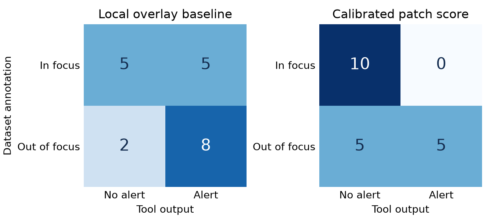
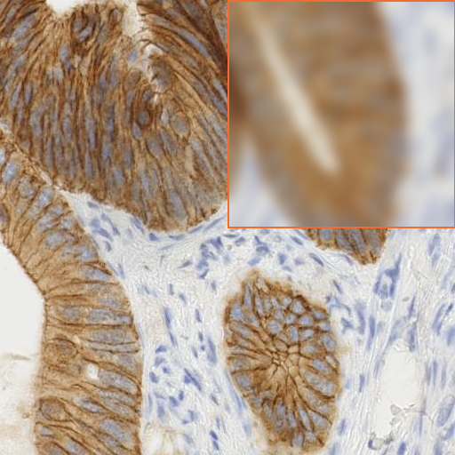
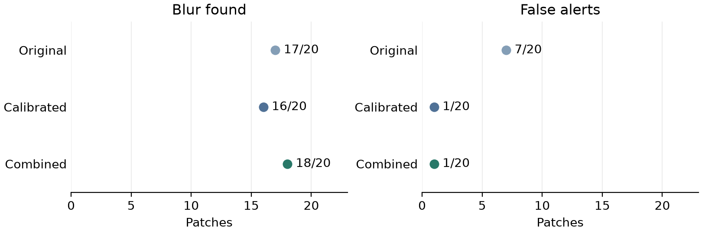
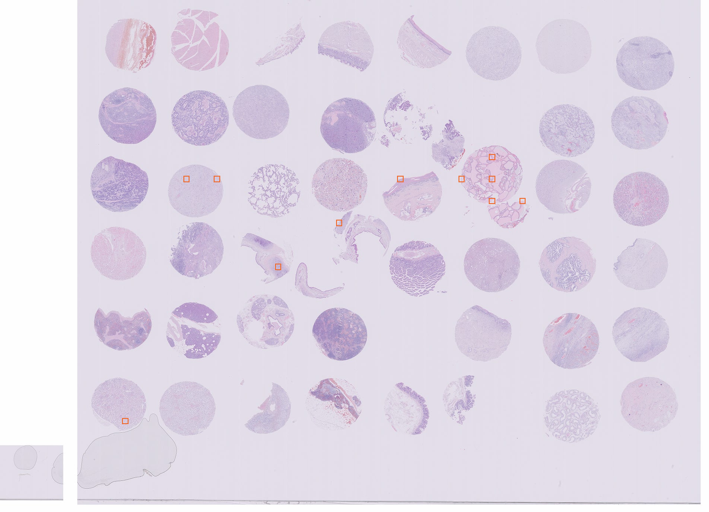

# Slide Quality Review

A small out-of-focus region can make a scanned tissue image hard to analyze, and it is easy to miss when reviewing a batch at thumbnail scale. I built Slide Quality Review to prioritize images with suspicious regions, show reviewers where to look, and turn their decisions into a rescan list.

[Open the browser tool](https://martaforjaz.github.io/slide-quality/)

Load the example pair or add a batch of PNG or JPEG images. The queue is sorted by the fraction of tissue tiles flagged. Toggle the overlay to inspect the original texture, record a decision, and export the decisions and region coordinates as CSV. Images are processed in the current browser tab and review state is kept for that session.

## Controlled validation

The example uses an IHC micrograph from the Center for Microscopy and Molecular Imaging, distributed by [scikit-image](https://scikit-image.org/docs/stable/api/skimage.data.html#skimage.data.immunohistochemistry). A second copy has a 192 × 192 pixel region blurred with a Gaussian filter. The original produced zero alerts across 52 eligible tiles. The edited copy produced seven alerts, all inside the injected region. Nine grid tiles intersect the region, and the tissue mask determines which tiles are eligible.

[Raw validation results](results.json)

The algorithm filters low-saturation background and compares local Laplacian energy with the upper quartile of tissue tiles in the same image. Relative scores prioritize localized patches. Tissue texture and magnification can affect alerts and uniformly blurred images can lack a sharp internal reference. The validation uses one source micrograph and controlled blur. Performance on scanner-native focus defects and time savings in a human review study remain unmeasured. Inputs are raster previews, resized to at most 1,600 pixels on the long side.

## Reproduce

```sh
pip install scikit-image Pillow
python prepare_example.py
node evaluate.mjs
python -m http.server 8781 --directory site
```

Open http://127.0.0.1:8781. No thesis data or code is included.

## Real scanner validation



I sampled **40 TCGA@Focus patches from 40 different source slides** across adrenal gland, bladder, brain, breast and bronchus/lung. The source labels are region-level focus annotations. Twenty patches were reserved for calibration and twenty for evaluation. Both splits contain ten in-focus and ten out-of-focus patches. The cohort manifest records the exact ZIP members, and the acquisition script uses HTTP range requests to avoid downloading the full archive.

| Held-out result | Found blur | False alerts | Clear patches correctly passed | Missed blur |
| --- | ---: | ---: | ---: | ---: |
| Original local heuristic | 8/10 | 5/10 | 5/10 | 2/10 |
| Calibrated patch score | 5/10 | 0/10 | 10/10 | 5/10 |

The local heuristic treats a patch as an alert if any eligible sub-tile falls below 20% of that image's upper-quartile focus energy. The calibrated mode uses median absolute Laplacian energy and selects its threshold on the calibration slides only, maximizing balanced accuracy and preferring fewer false alerts on ties. The two modes make different tradeoffs. The calibrated mode reduced false alerts in this sample while missing more annotated blur. The demo offers both modes for the scanner examples. Results are patch-level and do not establish pixel-level localization accuracy or generalization to other scanners.

[Per-patch predictions](scanner-results.json) · [Cohort manifest](cohort.json) · [Source dataset and licence](https://zenodo.org/records/3910757)

To rerun the scanner benchmark, install remotezip, requests and matplotlib alongside Pillow, then run:

```sh
python acquire_tcga.py
node evaluate_scanner.mjs
python render_scanner.py
```

## Supported inputs

The browser tool accepts exported PNG and JPEG tiles or raster previews. Scanner formats such as SVS, NDPI, MRXS and pyramidal OME-TIFF need a separate reader to extract tiles at a consistent magnification. Importing a downsampled screenshot of a whole slide cannot reveal focus defects at native resolution. The absolute threshold in this project is applied to the provided TCGA examples. User uploads use the local overlay, whose scores depend on stain, texture, compression and scale.

## Review a WSI folder

Download the repository and run these commands on the computer that can already open the slide folder. On Windows, paste the full UNC path beginning with two backslashes in the desktop window, or use **Browse**. Select **Review folder** to open the report.

```sh
pip install openslide-python openslide-bin numpy Pillow psutil
python desktop.py
```

For a saved report or scripted runs, use `python review_folder.py "PATH_TO_SLIDES" --output "PATH_TO_REPORT"`. The report stores a reduced PNG of each slide, a second PNG with suspicious sampled regions, and an alerts CSV with level-zero coordinates. Desktop runs create a separate local temporary report for each batch. Files are read locally with the current Windows account; nothing is uploaded to the portfolio.

OpenSlide must recognize the scanner format. The reader selects a pyramid level near 10× when the objective is recorded, samples a bounded grid, and scores tissue regions. Large single-level TIFFs use a 12 × 12 map of sampled windows to avoid decoding the entire slide to make a thumbnail. Each map cell shows the corresponding sample rather than all the tissue between samples. The CSV always uses the original level-zero coordinates. Sampling can miss small focus defects, and the WSI workflow has not been validated across scanner formats or on the private example folder.

### Public folder example



This example generates two tiled TIFFs from the public scikit-image micrograph: a reference and a copy with simulated blur in one grid cell. Run `pip install tifffile` and `python public_folder_example.py` to generate the input folder, PNG previews, HTML report and CSV locally. The [example CSV](figures/public-tiff-alerts.csv) reports the flagged region in level-zero coordinates. This checks the folder workflow on a controlled image; the TCGA@Focus experiment above evaluates real scanner defocus separately.

## Expanded scanner validation



The combined detector found **18 of 20 blurred patches** and gave **one false alert in 20 clear patches**. On the same images, the original found 17 and gave seven false alerts. The earlier calibrated detector found 16 and gave one false alert.

The new detector fits a logistic model to four features derived from the distribution of tissue-tile Laplacian and gradient energy. It uses the original 40 slides for fitting and **40 previously unseen slides** for evaluation, with one annotated patch per slide. The operating threshold is the standard logistic decision boundary. [Results and per-patch predictions](holdout-results.json) · [Holdout manifest](holdout.json)

The combined score is available in the public TCGA@Focus example batch. Whole-slide folder reviews and local overlays continue to use their own relative scoring workflow. This test measures patch-level alerts within TCGA@Focus, with no cross-scanner or whole-slide validation.

After acquiring the original cohort, install scikit-learn and run:

```sh
python acquire_holdout.py
node score_holdout.mjs
python train_focus.py
python render_holdout.py
```

The folder report shows original and combined alerts side by side. Both methods read the same sampled windows. The combined score applies the public TCGA@Focus model to 64-pixel subtiles within each window, and the CSV marks regions flagged by either method along with their coordinates and scores. The TCGA patch benchmark does not validate this application across WSI scanners and magnifications. Use the paired previews for manual review.

## Aggregate comparison on a separate WSI batch

Across seven 40× slides, the original detector flagged **18 of 255** sampled tissue regions. The combined detector flagged **98 of the same 255**, including all 18 original alerts. These slides had no reference focus annotations. The counts measure review workload and agreement between the detectors.

## Public whole-slide example on PLISM

On the public **MY_P.tiff** whole slide, the original detector flagged **11 of 145** sampled tissue regions, and the combined detector flagged **5 of 145**. All five combined alerts overlap the original alerts. PLISM does not provide reference focus labels for this comparison, so the difference measures review workload on this example.

| Original detector | Combined detector |
| --- | --- |
|  |  |

[Public example CSV](figures/plism-alerts.csv). Download MY_P.tiff from the [PLISM Original Whole Slide Images Dataset](https://doi.org/10.25452/figshare.plus.24988074.v1) and run `python review_folder.py PATH_TO_PLISM_FOLDER --output plism-report` to regenerate the previews and CSV.

Image source: Mieko Ochi, Daisuke Komura and colleagues, PLISM, [CC BY 4.0](https://creativecommons.org/licenses/by/4.0/). The figures show reduced views with added focus-alert outlines.


## Review decisions and recovery

[Open the public PLISM review session](https://martaforjaz.github.io/slide-quality/public-review/).
Select an alert to inspect its region at level-zero resolution. Record a decision and move to the next alert. Decisions persist in the current browser. Download the review JSON to reopen it elsewhere or export the regions marked for rescanning as CSV.

For a local folder, rerun the same command with the same output directory after an interruption. The scanner saves a checkpoint after each completed slide and reprocesses slides with changed inputs or detector code. Use one process per output directory. To pause after a known number of new slides, pass `--max-slides N`.

`python test_resume.py` terminated a two-slide process after its first durable checkpoint. After restart, it reused one slide, processed the remaining slide and produced zero duplicate alert rows. See [recovery results](resume-results.json).

The 145-region public PLISM example took 4.69 seconds for the slide processing step on one Windows run. The OS reported 37.3 MB of process reads and a 105 MB peak working set. The I/O counter is process-wide and does not measure TIFF payload or network traffic directly. See [run metrics](figures/plism-run-metrics.json).

## Sensitivity to image resolution

On the same 40 held-out TCGA@Focus patches (20 blurry and 20 clear), the combined detector found 18 blurry patches with 1 false alert at the original resolution. When width and height were halved, it found 9 with zero false alerts. At quarter size, it found 4 with zero false alerts. The original detector found 17, 14 and 9 blurry patches and produced 7, 3 and 1 false alerts, respectively.

Use the combined result to prioritize review at the evaluated patch resolution. Lower-resolution inputs need separate calibration before using a low alert count as a sign of acceptable focus. Digital resizing isolates sensitivity to resolution on these patches. This experiment does not measure how focus detection transfers between scanners or estimate whole-slide sensitivity.

See [all counts](resolution-results.json). With the held-out patch files in `cache/patches`, run `node evaluate_resolution.mjs` from the repository root to reproduce the comparison.
